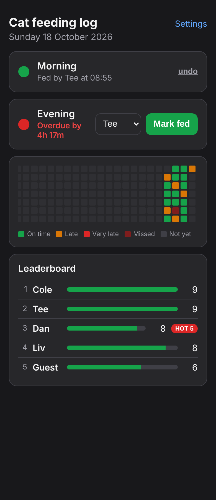
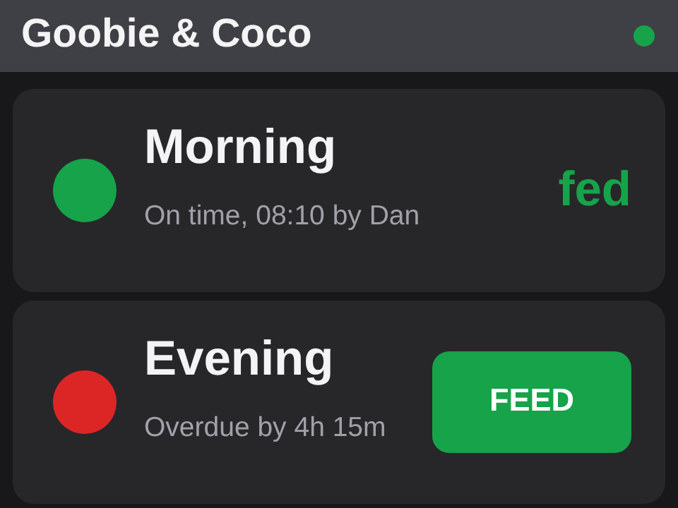
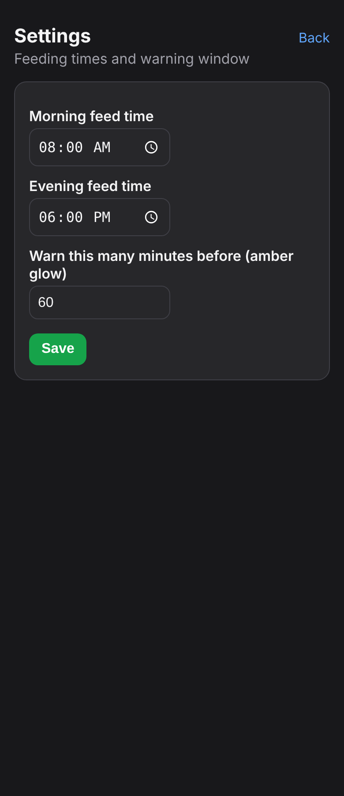

# Have the cats been fed?

A small home-lab project: an unidentified single-board computer found in a drawer, turned into
an always-on web app and a touchscreen wall panel that answer one very important question in a
shared house: **has anyone fed Goobie & Coco yet?**

It runs entirely on the home network. No cloud, no accounts, no app store.

<p align="center">
  
  &nbsp;&nbsp;
  
</p>

*Left: the web app as housemates see it on their phones. Right: the ESP32 touchscreen panel on the
wall (layout rendering).*

---

## The story

### 1. "What even is this?"
It started with a green circuit board covered in ports, roughly the shape of a Raspberry Pi but
not one. It turned out to be an **Orange Pi PC v1.3** from 2015: an Allwinner **H3** quad-core,
1 GB RAM, 100 Mbit wired Ethernet, no Wi-Fi, boots from microSD, powered only through a barrel
jack (not the micro-USB port, which is a trap). Worth about a tenner secondhand, but perfectly
capable of being a tiny always-on server.

### 2. A short Kali detour
The first idea was to make it a little Linux security-learning box. Armbian's imager even offers a
Kali build for it. In the end that was more OS than this job needed, so it was wiped and the board
went back to a clean, minimal **Armbian (Debian 13)**. (Cleaning up the half-installed Kali
packages afterwards was its own small adventure in `dpkg --force-downgrade`.)

### 3. Getting it on the network (the fiddly part)
A minimal server image is bare, and this board had some character:

- The Ethernet interface isn't `eth0`, it's **`end0`** on modern kernels, and the image shipped
  without `dhclient`, `nmcli` or `systemd-networkd`, so the network had to be brought up by hand.
- The H3 has a well-known quirk: after a soft `reboot` the interface gets an IP but passes **no
  traffic** until the link is bounced (`ip link set end0 down; up`). A cold power-cycle is clean.
- The onboard MAC can randomise per boot, so instead of fighting DHCP it was pinned to a **static
  IP** via a tiny `systemd` one-shot that bounces the link and assigns the address on boot.

(And yes, a good chunk of debugging turned out to be "the cable was in the wrong port".)

### 4. The app
With the board reachable, the actual point: a single-file **Flask + SQLite** web app, no framework
sprawl, that housemates open on their phones to log the cat's **morning** and **evening** meals.
One row per meal per day, so a meal can't be double-logged, and it resets itself each day.

It grew a few thoughtful touches over a handful of iterations:

- A **settings page** to set the feed times and how early to start warning.
- A per-meal **status dot** that glows: grey (not due), amber (due soon), red (overdue), green
  (fed, with who and when). The page refreshes itself, so it's good as an always-on tab.
- A **GitHub-style contribution grid** of the last few months, one square per day coloured by how
  on-time the feeds were (green on time, amber late, red very late, dark red missed).
- A **leaderboard** ranking housemates by total feeds, with a **"HOT" streak** badge once someone
  feeds 3+ days in a row.

<p align="center">
  
</p>

### 5. The wall panel
The final piece: a **"Cheap Yellow Display" (ESP32-2432S028R)** — a cheap ESP32 board with a 2.8"
touchscreen — mounted where the cats get fed. It joins the home Wi-Fi and talks to the Pi over a
small JSON API the app exposes (`/api/status`, `/api/feed`). It shows the same green/amber/red
status, and anyone can tap a meal, pick their name, and log a feed without reaching for a phone.
It polls every 15 seconds, so the panel and everyone's phones always agree.

One real-hardware gotcha made the final cut as a one-liner: many of these panels invert the
ILI9341's colours, so the dark theme came up white-on-black until a `tft.invertDisplay(true)` set
it right.

---

## What's in here

| Path | What it is |
|---|---|
| `cat-feeder-app/app.py` | The whole web app. Single Python file, Flask + SQLite. |
| `cat-feeder-app/deploy-guide.md` | How to put it on the Orange Pi as a `systemd` service. |
| `cat-feeder-cyd/cat_feeder_cyd.ino` | The ESP32 touchscreen firmware. |
| `cat-feeder-cyd/User_Setup.h` | TFT_eSPI pin config for the CYD board. |
| `cat-feeder-cyd/README.md` | Flashing and wiring guide for the panel. |

## Run the app yourself

```bash
cd cat-feeder-app
pip install flask
python3 app.py
# open http://localhost:8000
```

Edit `HOUSEMATES` and `CATS` at the top of `app.py` for your own household. Feed times are set in
the app's Settings page. Full server deployment (auto-start on boot) is in
[`cat-feeder-app/deploy-guide.md`](cat-feeder-app/deploy-guide.md).

## Hardware

- **Server:** Orange Pi PC v1.3 (Allwinner H3), or honestly any Linux box / Raspberry Pi. It's just
  Python.
- **Panel (optional):** ESP32-2432S028R "Cheap Yellow Display". Flashing guide in
  [`cat-feeder-cyd/README.md`](cat-feeder-cyd/README.md).

## A note on privacy

This whole thing lives on the home LAN and was never exposed to the internet, which is exactly why
these are screenshots rather than a live link. No credentials are committed: the Wi-Fi fields in
the firmware are placeholders you fill in locally, and the feed database (`feeds.db`) is gitignored.

## Tech

Python 3, Flask, SQLite, plain HTML/CSS (no build step, no JS framework). Firmware in C++ with
TFT_eSPI, XPT2046_Touchscreen and ArduinoJson. Built on an Orange Pi PC running Armbian.
